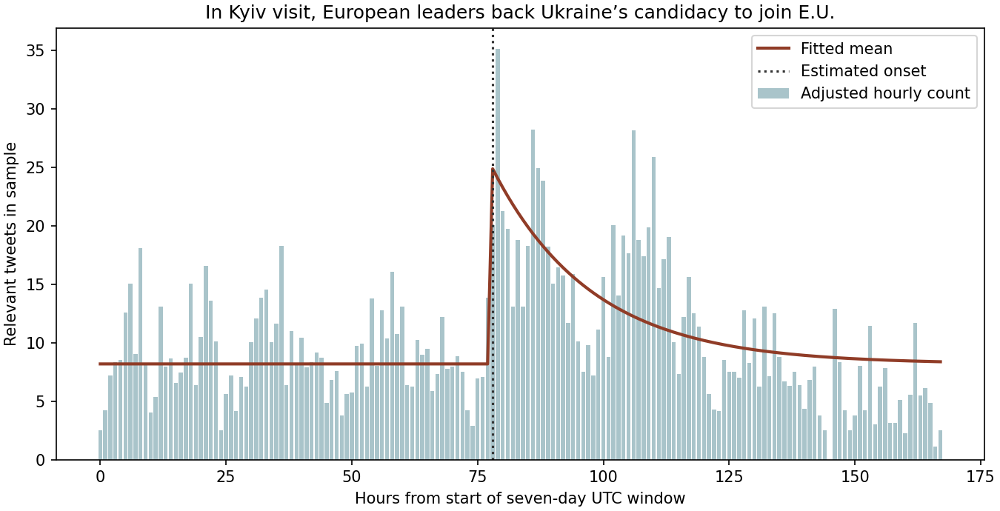
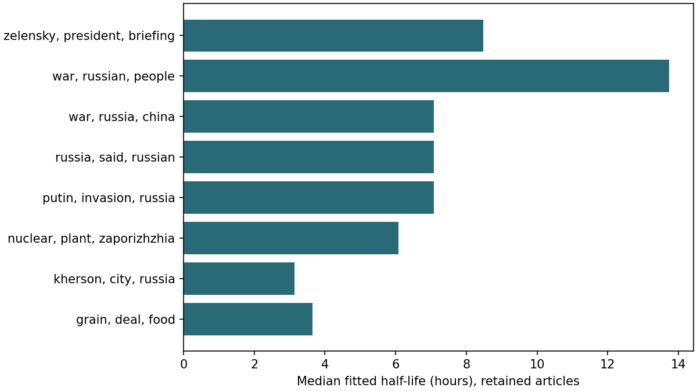

# Twitter discourse around Washington Post articles

The archive contains 740 article records. The three-worker Dask run fitted 683 complete seven-day windows. Of these, 210 reached the descriptive inclusion threshold of R² ≥ 0.25 with a positive burst. The median retained fit explained 40% of within-window variation. Across retained articles the median half-life was 7.08 hours. Overlapping windows and repeated stories can share tweets.

| Outcome                    |   Articles |
|:---------------------------|-----------:|
| weak fit                   |        473 |
| retained                   |        210 |
| incomplete hourly coverage |         54 |
| no coverage                |          3 |

## How to read a fit

The light bars give the sampled count above the article-specific 95th percentile of text similarity, scaled for hour-of-day traffic. The curve starts at the pre-event baseline. At onset it jumps to the post-event baseline plus the burst amplitude, then approaches the post-event baseline. Both baselines and the amplitude are in adjusted tweets per hour. The log amplitude corresponds to φ in the README. The decay rate α is per hour, and ln(2)/α gives the time for the excess above the post-event baseline to halve. Residual SD measures typical scatter around the fitted curve. The onset can precede publication because coverage can follow an event already under discussion.

Article 385 is the middle retained article ranked by R². Its fitted onset is hour 78. Its baselines are 8.2 before onset and 8.2 afterward, with an additional 16.7 at onset. Its half-life is 13.74 hours and R² is 0.40.

## Topics and attention

Eight seeded k-means clusters use TF-IDF features from all headlines and descriptions. The three largest centroid terms label each cluster. The table reports the number of articles and retained fits, then medians among retained fits. Small groups, repeated briefing language, the fixed half-life grid and fit selection limit comparisons.

Among clusters with at least five retained fits, the median half-life ranged from 3.14 hours for “kherson, city, russia” to 13.74 hours for “war, russian, people”.

| topic                         |   articles |   retained |   half_life_hours |   amplitude |   r2 |
|:------------------------------|-----------:|-----------:|------------------:|------------:|-----:|
| grain, deal, food             |         31 |         14 |              3.65 |       25.49 | 0.56 |
| kherson, city, russia         |         52 |         16 |              3.14 |       16.12 | 0.35 |
| nuclear, plant, zaporizhzhia  |         48 |         10 |              6.08 |       19.53 | 0.36 |
| putin, invasion, russia       |        112 |         37 |              7.08 |       21.17 | 0.48 |
| russia, said, russian         |        130 |         41 |              7.08 |       18.81 | 0.46 |
| war, russia, china            |        146 |         36 |              7.08 |       14.28 | 0.37 |
| war, russian, people          |        113 |         20 |             13.74 |       13.3  | 0.37 |
| zelensky, president, briefing |        108 |         36 |              8.47 |       16.65 | 0.35 |

Text similarity measures attention to related language. This analysis cannot establish sentiment, readership, or a causal effect of publication. The fit threshold is an in-sample descriptive choice. Parameter estimates have no posterior uncertainty intervals.

[Article-level results](articles.csv) · [Hourly observations and fitted values](hourly.parquet) · [Topic summaries](topics.csv)
